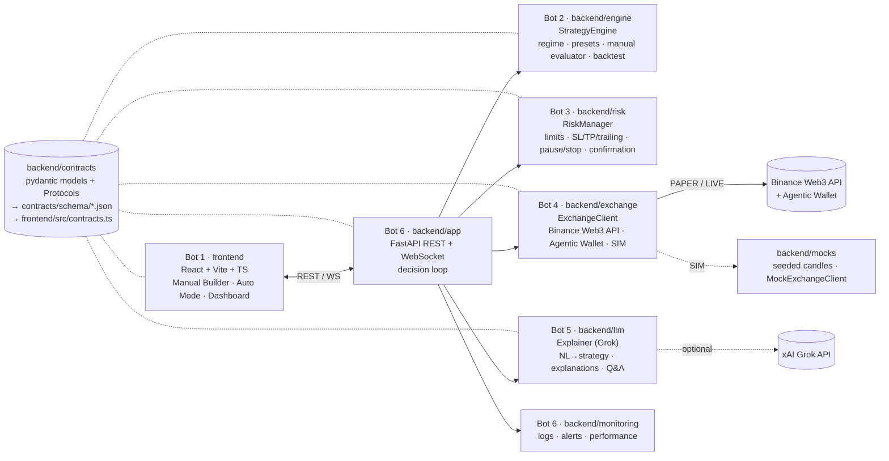

# teamwork — Autonomous Trading Agent for Tokenized On-Chain Stocks

Hackathon project: an autonomous agent that trades tokenized stocks (NVDAon, TSLAx, AAPLB — Ondo / xStock / BStock
style tokens) using **Binance Agent Studio**, the **Binance Web3 API** (market data + trading) and the **Binance Agentic Wallet**.
It is safe, transparent and explainable, and runs in **simulation first** (SIM → PAPER → tiny LIVE, clearly separated).

- **Manual Mode** — the user builds a rule set (RSI, SMA, EMA, MACD, Bollinger, volume, breakouts, AND/OR, TP/SL/trailing,
  RSI and MACD exits, position size, max positions, cooldown, filters), saves it as JSON, backtests it, and activates it in
  auto-execute or confirmation mode. Functional reference: [`reference/full_strategy_builder_simulation.html`](reference/full_strategy_builder_simulation.html).
- **Auto Mode** — the agent detects one of 6 regimes, maps *(regime, trader style)* to **exactly one** preset agent
  (DCA, Smart DCA, Buy the Dip, Trend/Momentum, Grid), evaluates only that one and outputs **BUY** or **STAY OUT** with a reason.
  Decision flow: risk check → regime → map(regime, style) → evaluate → risk check → buy / ask confirmation / stay out.

Built in parallel by six bots, each owning one directory — see [CONTRIBUTING.md](CONTRIBUTING.md).

## Architecture



Per-bar decision loop (in `backend/app`): `RiskManager.check_exits` → `StrategyEngine.evaluate_manual | evaluate_auto` → `Signal`
→ `RiskManager.check` → `RiskVerdict` → (confirmation?) → `ExchangeClient.get_quote` + `execute_swap | execute_rfq` → `Decision`
→ `Explainer.explain_decision` → log + WebSocket `Event`. The risk layer can always force STAY_OUT; the LLM never executes trades.

## Repository layout

| Path | Owner | What |
|---|---|---|
| `backend/contracts/` | coordinator | **Single source of truth**: pydantic models, enums, module Protocols |
| `backend/mocks/` | coordinator | Deterministic mock candles (each regime) + `MockExchangeClient` |
| `contracts/schema/` | generated | JSON Schema per model (`python scripts/gen_contracts.py`) |
| `frontend/` | Bot 1 | UI & Manual Builder (React + Vite + TS); `src/contracts.ts` is generated |
| `backend/engine/` | Bot 2 | Strategy & Regime Engine |
| `backend/risk/` | Bot 3 | Risk & Control |
| `backend/exchange/` | Bot 4 | Binance Web3 API + Agentic Wallet + SIM |
| `backend/llm/` | Bot 5 | Grok explanations / NL → strategy (template fallback) |
| `backend/app/`, `backend/monitoring/`, `tests/e2e/` | Bot 6 | Integration, API, testing, monitoring |
| `reference/` | coordinator | Reference simulator + notes on spec mismatches |

## Running

Requirements: Python 3.11+, Node 20+.

```bash
# backend
python -m venv .venv && source .venv/bin/activate      # on the shared box: source /workspace/.venv/bin/activate
pip install -e ".[dev]"
cp .env.example .env                                    # TRADING_MODE=SIM needs no keys
pytest                                                  # all tests
uvicorn backend.app.main:app --reload --port 8000       # http://localhost:8000/docs

# frontend
cd frontend && npm install
npm run dev                                             # http://localhost:5173 (proxies /api and /ws to :8000)
npm run build
```

After changing anything in `backend/contracts/` (coordinator only): `python scripts/gen_contracts.py` and commit the
regenerated `contracts/schema/` and `frontend/src/contracts.ts`. CI fails if they are stale.

## Modes & secrets

`TRADING_MODE` = `SIM` (offline mocks, default) · `PAPER` (real market data, simulated fills) · `LIVE` (real, tiny, opt-in).
Secrets only via environment variables (`BINANCE_API_KEY`, `BINANCE_API_SECRET`, `XAI_API_KEY`) — never commit `.env`.
