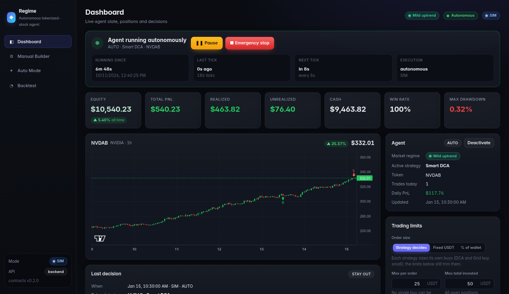
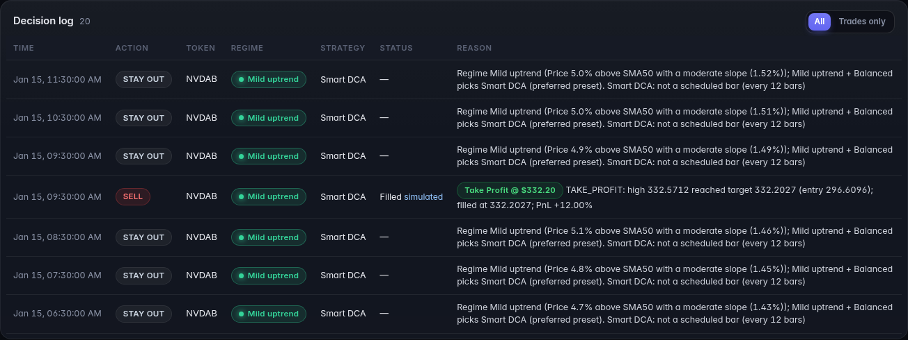
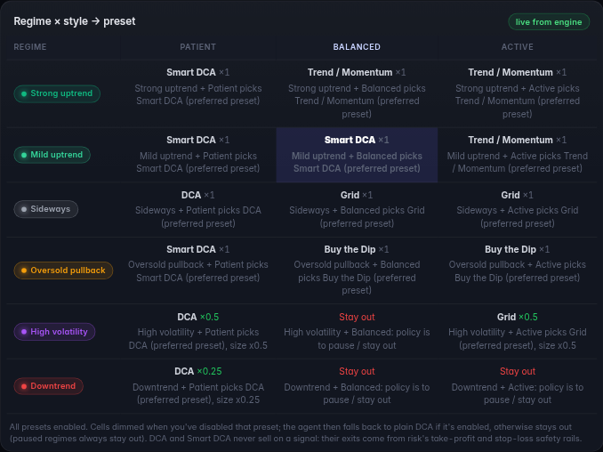
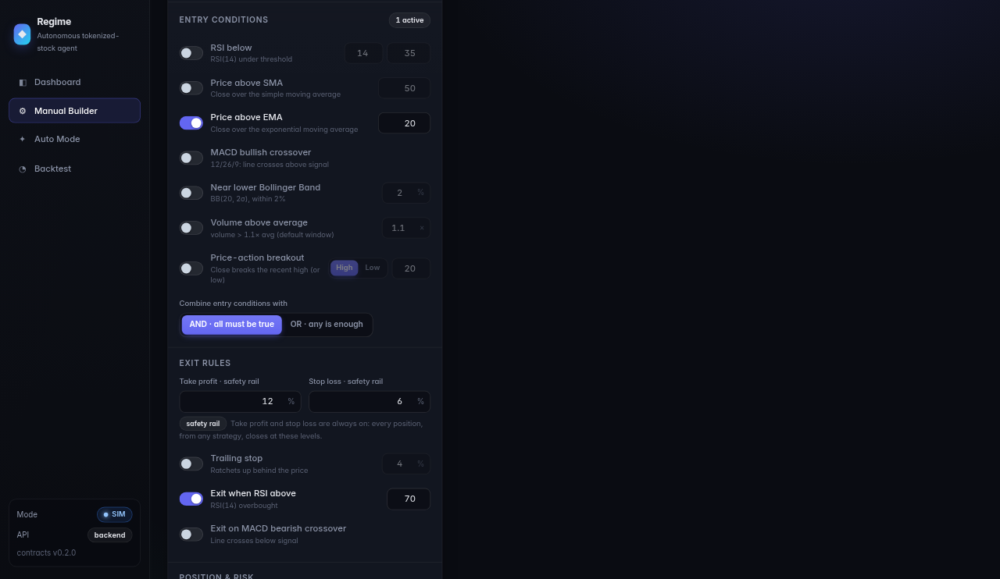
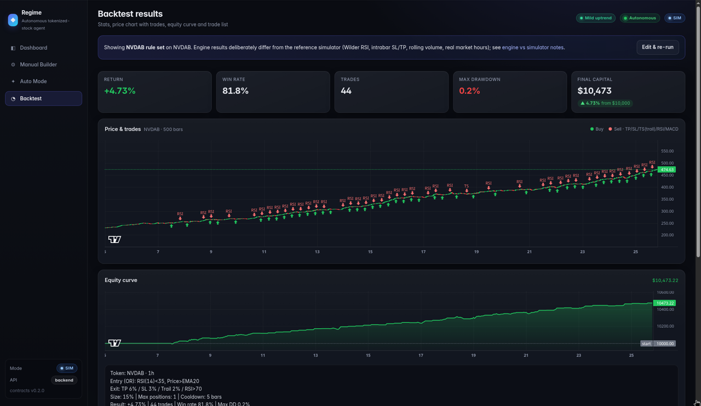
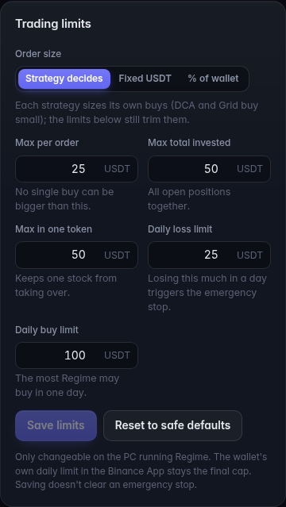
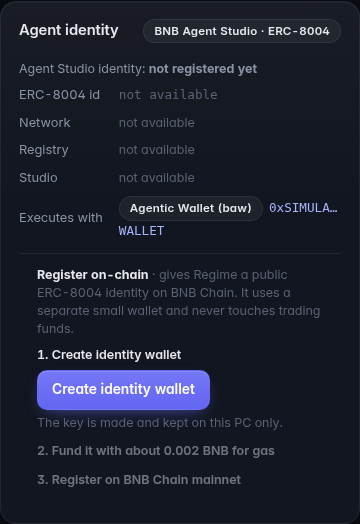
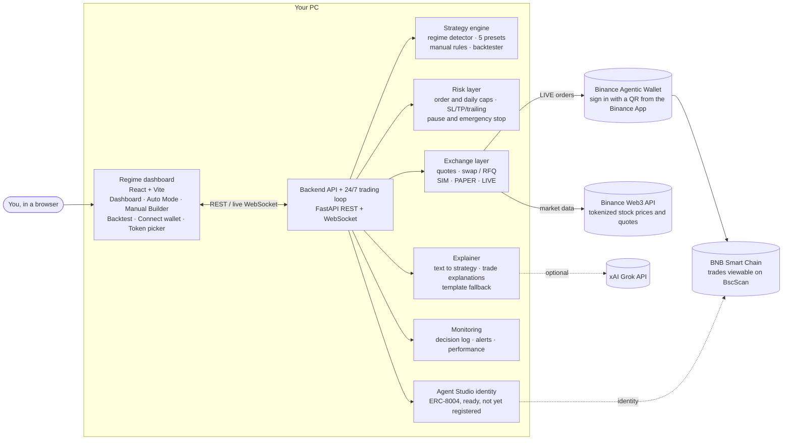

# Regime

**An autonomous agent that reads the market regime and trades tokenized stocks 24/7 on BNB Chain mainnet through the
Binance Agentic Wallet, with hard safety limits and a plain-English reason for every decision.**

Built for BNB Hack: Tokenized Stocks Edition. Tokens: **NVDAB** (default) and other bStocks, Ondo tokens (`…on`) during
US market hours; xStocks (`…x`) are off by default.



**Live on mainnet:** Regime's first autonomous trade bought 10 USDT of NVDAB on 11 Oct 2026 at 09:25 IST.
[View it on BscScan](https://bscscan.com/tx/0x228c02688cd2a8170b38dba6abfdb4f95fca9e9e22ae6bed6a191d0b88a19f22).

**Docs:** [Developer Experience Report](docs/dx-report/) · [Demo script](docs/demo-script.md) ·
[Going live with real funds](backend/app/GO_LIVE.md) · [API reference](backend/app/API.md)

**Status:** explanations use built-in plain-English templates unless `XAI_API_KEY` is set (then xAI Grok writes them,
with the templates as fallback). The BNB Agent Studio identity (ERC-8004) is prepared in
[`backend/agent_studio/`](backend/agent_studio/) but not registered on-chain yet.

## Run Regime on your computer

**You need:** [Git](https://git-scm.com/downloads), [Python 3.11+](https://www.python.org/downloads/) and [Node.js 20+](https://nodejs.org/). Check them with `git --version`, `python --version` (`python3 --version` on macOS/Linux) and `node --version`.

**1. Get the code**
```bash
git clone https://github.com/rishu4436/regime.git
cd regime
```

**2. Start it.** One command, run from the repo root, installs everything on the first run (a `.venv` and the dashboard's npm packages) and starts both parts.
- macOS / Linux: `backend/app/deploy/run.sh`
- Windows (PowerShell): `.\backend\app\deploy\run.ps1`

  If Windows refuses to run the script ("running scripts is disabled on this system"), allow it for this window only with `Set-ExecutionPolicy -Scope Process Bypass`, then run it again.

**3. Open the dashboard** at http://localhost:5173. The backend's API docs are at http://localhost:8000/docs. Press Ctrl+C in the terminal to stop.

**4. Try it safely.** Regime starts in SIM mode, which uses no keys, no wallet and no real money:
- Choose a trading style in **Auto Mode** and Regime picks the strategy preset, or build your own rules in **Manual Builder** and backtest them.
- Turn on the agent and watch the **Dashboard**. Every buy or stay-out decision comes with a plain-English reason.
- There's no wallet to connect in SIM. The **Connect wallet** button appears only in LIVE mode, where it shows the Agentic Wallet's sign-in QR.

**5. Choose a mode.** Copy `.env.example` to `.env` at the repo root and set `TRADING_MODE`, then restart:

| Mode | What it does |
|---|---|
| `SIM` (default) | Offline sample market data, simulated trades |
| `PAPER` | Real Binance market data, simulated trades (needs `BINANCE_API_KEY` and `BINANCE_API_SECRET` for the Binance Web3 API) |
| `LIVE` | Real orders from your Binance Agentic Wallet on BNB Chain |

Optional: set `XAI_API_KEY` to have xAI Grok write the explanations. Without it, Regime uses its built-in plain-English templates.

**6. Go live (optional, real money).** Follow [GO_LIVE.md](backend/app/GO_LIVE.md). It covers installing the Agentic Wallet CLI, signing in with a QR code from the Binance App, the three wallet settings, funding (about 70 USDT minimum, 100 USDT is comfortable, plus ~0.005 BNB for gas) and the safety caps. Never commit `.env`. Keys go in environment variables or your git-ignored `.env` only.

**Saved data:** your strategies, the agent's state and its logs live in `logs/` inside the repo (git-ignored; set `LOG_DIR` to move it), so they survive a restart.

## How Regime decides

Every candle, Regime does three things.

**1. Read the market.** From the last 60 usable candles it puts the token in one of six regimes. It checks them in this order and takes the first match:

| Regime | What it means |
|---|---|
| High volatility | Price swings are large, with no clear direction |
| Oversold pullback | A sharp drop over the last 10 candles, with RSI below 30 |
| Downtrend | Price is below a falling 50-candle average |
| Strong uptrend | Price is well above a rising 50-candle average, with the 20-candle EMA above it |
| Mild uptrend | Price is above a gently rising 50-candle average |
| Sideways | Anything else: flat averages and calm prices |

The limits scale with the candle length, so 1-minute and 1-hour candles are judged fairly. With fewer than 60 usable candles, Regime says so, calls the market sideways with low confidence, and holds back.

**2. Pick one strategy.** Your trading style (Patient, Balanced or Active) plus the regime select exactly one of five built-in strategies: DCA, Smart DCA, Buy the Dip, Trend Following or Grid.

| Regime | Patient | Balanced | Active |
|---|---|---|---|
| Strong uptrend | Smart DCA | Trend Following | Trend Following |
| Mild uptrend | Smart DCA | Smart DCA | Trend Following |
| Sideways | DCA | Grid | Grid |
| Oversold pullback | Smart DCA | Buy the Dip | Buy the Dip |
| High volatility | DCA at half size | Stay out | Grid at half size |
| Downtrend | DCA at a quarter size | Stay out | Stay out |

If you've switched a strategy off, Regime falls back to the next suitable one. In a downtrend or wild market, the Balanced and Active styles simply stay out.

**3. Decide and explain.** That strategy says Buy, Sell or Stay out for the latest candle. Every decision comes with a plain reason naming the numbers behind it, such as "Grid: price at the top of the range, cell 5 of 5; buys only in the bottom cell". The risk layer then checks the trade against the safety limits before anything reaches the wallet.

**Manual mode** skips steps 1 and 2. You build your own rules from RSI, SMA, EMA, MACD, Bollinger Bands, volume and breakouts, combined with AND or OR. Exits can be take-profit, stop-loss, a trailing stop, an RSI exit or a MACD exit. The same engine runs your rules live and in the backtest, so the two give the same result for the same candles.

**Live safety in the engine.** Before any live buy, Regime also stays out if:
- the price data is stale
- the token is paused or closed, such as Ondo tokens outside US market hours
- liquidity is too thin
- the quote moves the price by more than 1%

Every rule above is deterministic, with no randomness, and covered by tests.

## Every trade comes with a reason

Regime explains each decision in plain English on the dashboard. Here is the explanation it logged for its first autonomous mainnet trade. It decided at 09:25:39 IST on 11 Oct 2026, and the trade filled at 09:25:53:

> LIVE, real funds, autonomous: Buy NVDAB (AUTO mode). Strategy: Grid, market regime: sideways. Reason: Market regime sideways (Flat SMA50 (slope -0.12%) and low volatility (0.60%)); sideways market with the Balanced style selects Grid (preferred preset). Grid: price in the bottom grid cell 1 of 5 (1 = bottom, 5 = top) of range 229.2-235.5; size raised to the token minimum (10.00 USDT). Conditions met: price in the bottom grid cell. Live risk checks passed ($10.00). The agent bought NVDAB on its own with real funds on BNB Chain mainnet: 10.00 USDT via SWAP at a fill price of 230.4707 (0.0433895 NVDAB, fee $0.05). Price impact unknown. Tx hash 0x228c02688cd2a8170b38dba6abfdb4f95fca9e9e22ae6bed6a191d0b88a19f22: https://bscscan.com/tx/0x228c02688cd2a8170b38dba6abfdb4f95fca9e9e22ae6bed6a191d0b88a19f22.

[View the transaction on BscScan](https://bscscan.com/tx/0x228c02688cd2a8170b38dba6abfdb4f95fca9e9e22ae6bed6a191d0b88a19f22).

This was logged by the version running at the time. The current version says "Regime" instead of "the agent" and "via a swap" instead of "via SWAP".

Stay-outs and blocks get the same treatment. For example, if a quote would move the price more than 1% against you, Regime says it stayed out and why, instead of showing an error code.

Explanations come from built-in templates, so they're the same every time and need no AI key. If you set `XAI_API_KEY`, Regime asks xAI Grok to write them instead and falls back to the templates if Grok fails. Either way, the explainer only describes what happened. It can never place a trade.

## Safety limits

Regime trades real funds on its own, so the risk layer checks every live buy against hard limits before it reaches the wallet. No human approves trades. You can turn on confirmation mode if you want to approve each one.

**Three switches to go live.** Live trading needs `LIVE_TRADING_ENABLED`, `BINANCE_LIVE_ENABLED` and `RISK_ALLOW_LIVE` all set to true. If any one is off, Regime can't spend real money.

**Hard caps (live defaults, in USDT):**

| Limit | Default |
|---|---|
| Max per order | 25 |
| Max bought per day (UTC), fees included | 100 |
| Max value of all open positions | 50 |
| Max loss per day, which triggers an emergency stop | 25 |

Your Binance Agentic Wallet has its own spending limits too, and Regime applies whichever is stricter. It also keeps enough of the wallet's daily quota free to sell what it already holds.

**Before every buy, Regime stays out if:**
- the price data is more than 15 minutes old
- the quote has expired, or the price impact is more than 1% against you
- the quote looks more than 3% too good, which usually means bad data
- the token is paused, closed or has no liquidity
- the wallet can't cover the order plus a 1 USDT fee buffer and 0.002 BNB for gas
- a buy that is still settling on-chain already counts toward today's limits

**Exits always go through.** Stop-loss, take-profit and trailing-stop sells are never blocked by a buy guard. They're checked against each candle's high and low, not just its close.

**You stay in control.** The dashboard has Pause and an Emergency stop. An emergency stop blocks every buy and closes open positions, and it stays on until you reset it. If a different wallet connects, or the wallet sign-in drops, Regime places no orders until you check positions or reconnect.

Every rule above is covered by tests in [`backend/risk/tests/`](backend/risk/tests/).

## Binance integration

- **Market data and quotes:** the Binance Web3 API (signed requests). It provides candles, prices, token status (trading, off-hours, no liquidity) and the minimum order per token, plus swap quotes with their price impact.
- **Execution:** the Binance Agentic Wallet CLI (`baw` 1.10.0) on BNB Smart Chain. Regime never holds a private key. The wallet signs in the Binance app, and its own daily limit and "abnormal transaction" setting apply on top of Regime's limits.
- **Connect wallet:** the dashboard shows the wallet's sign-in QR and pairing code. You scan it in the Binance app, and the backend confirms the wallet and re-reads its limits before trading. Sign-in only works from the PC running the backend.
- **No double orders:** every live swap is written to a local order journal before it's sent. If the result is unclear, Regime checks the wallet's orders on its next tick and never retries blindly. A swap that's still settling counts as an open position.
- **Tokens:** bStocks (`…B`, such as NVDAB) trade 24/7. Ondo tokens (`…on`) only fill during US market hours. xStocks (`…x`) are off by default because they have no BSC liquidity.
- **Proof:** Regime's first autonomous mainnet trade bought 10 USDT of NVDAB on 11 Oct 2026. [View it on BscScan](https://bscscan.com/tx/0x228c02688cd2a8170b38dba6abfdb4f95fca9e9e22ae6bed6a191d0b88a19f22).

## More screenshots

| | |
|---|---|
| <br/>**Trade explanation:** every decision with its plain-English reason. | <br/>**Auto mode:** the regime picks one preset for your trading style. |
| <br/>**Manual builder:** your own entry and exit rules, no code. | <br/>**Backtest:** the same engine run on past candles before going live. |
| <br/>**Trading limits:** set order size and spending caps from the dashboard. | <br/>**Agent Studio:** register Regime's public ERC-8004 identity on BNB Chain. |

## Architecture



On every new bar, the loop first checks stop-loss, take-profit and trailing stops. Then the engine detects the market regime and either picks a preset or runs your manual rules. The risk layer approves or blocks the trade, and it can always force Stay Out. Approved trades get a quote and execute through the Agentic Wallet. The explainer writes up why in plain English, and the result shows up on the dashboard right away. The LLM never places trades.

| Path | Module | What |
|---|---|---|
| [`frontend/`](frontend/) | Dashboard | Manual Strategy Builder, Auto Mode, dashboard, wallet sign-in (React + Vite + TS) |
| [`backend/engine/`](backend/engine/) | Strategy engine | Regime detection, 5 preset strategies, manual rules, backtester |
| [`backend/risk/`](backend/risk/) | Risk | Hard caps, SL/TP/trailing, cooldowns, pause / emergency stop, confirmation mode |
| [`backend/exchange/`](backend/exchange/) | Exchange/Wallet | Binance Web3 API (signed), Agentic Wallet (`baw`), SIM client |
| [`backend/llm/`](backend/llm/) | Explainer | Plain-English reasons, natural language → strategy (templates, optional Grok) |
| [`backend/app/`](backend/app/), [`backend/monitoring/`](backend/monitoring/) | App/Integration | FastAPI + WebSocket, 24/7 decision loop, alerts, state |
| [`backend/agent_studio/`](backend/agent_studio/) | Agent identity | ERC-8004 registration (prepared, not registered yet) |
| [`backend/contracts/`](backend/contracts/) | Contracts | Single source of truth: pydantic models, enums, module Protocols |
| [`backend/mocks/`](backend/mocks/), [`tests/e2e/`](tests/e2e/) | Tests | Seeded candles per regime, end-to-end tests |
| [`reference/`](reference/) | Reference | The functional strategy-builder simulator the UI follows |

## Development

```bash
python -m venv .venv && source .venv/bin/activate
pip install -e ".[dev]"
cp .env.example .env                                    # TRADING_MODE=SIM needs no keys
pytest tests/ && pytest backend/                        # all tests
uvicorn backend.app.main:app --reload --port 8000       # http://localhost:8000/docs
cd frontend && npm ci && VITE_API_MODE=http npm run dev # http://localhost:5173
```

`TRADING_MODE` = `SIM` (offline mocks, default) · `PAPER` (real market data, simulated fills) · `LIVE` (real funds, opt-in).
Secrets only via environment variables (`BINANCE_API_KEY`, `BINANCE_API_SECRET`, `XAI_API_KEY`); never commit `.env`.
After changing `backend/contracts/`, run `python scripts/gen_contracts.py` (CI fails if the generated files are stale).
How the code is split: [CONTRIBUTING.md](CONTRIBUTING.md).
